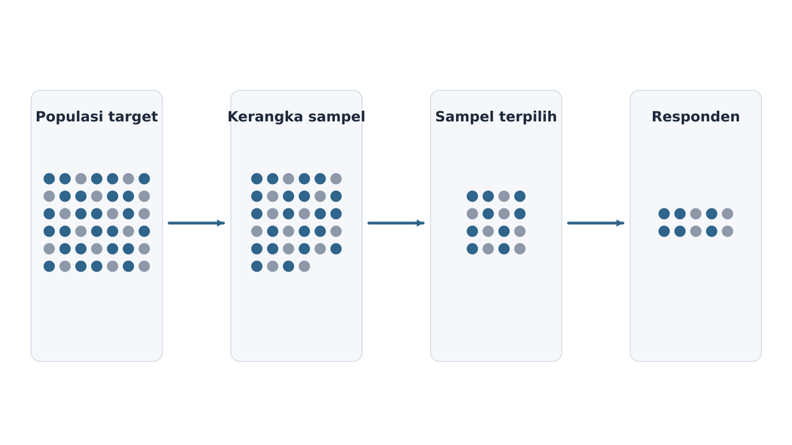
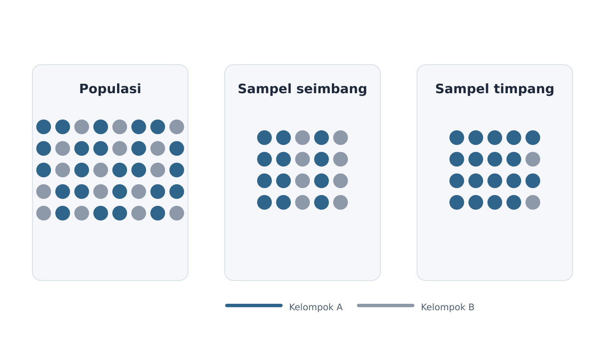
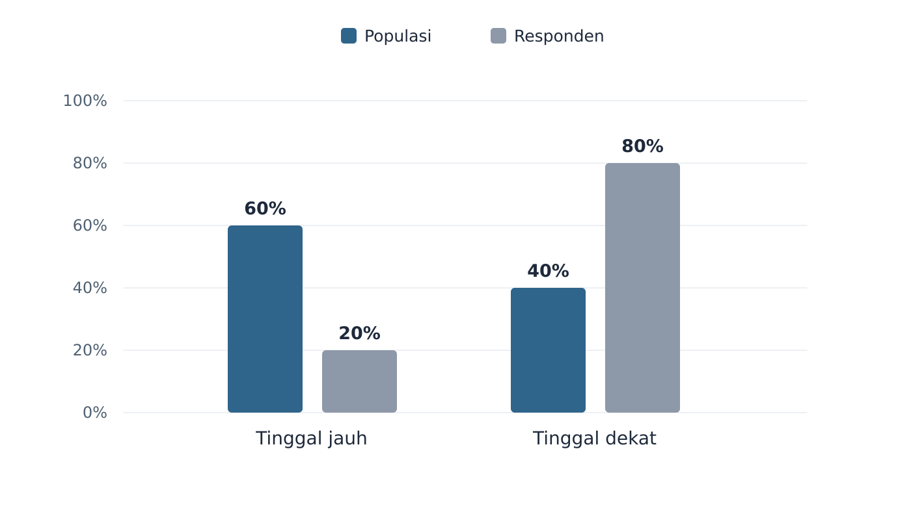
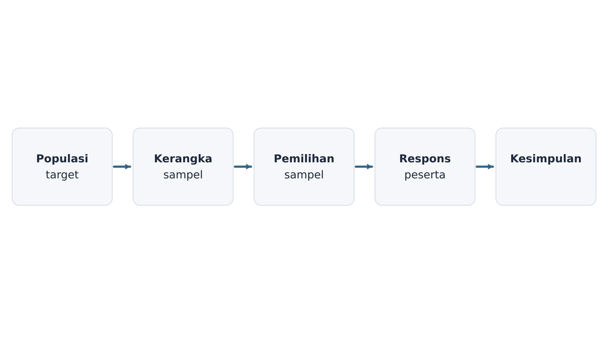
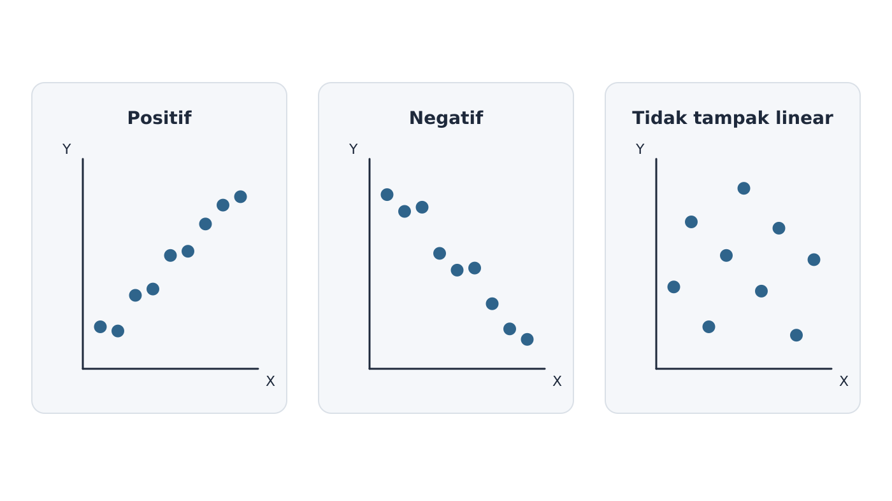
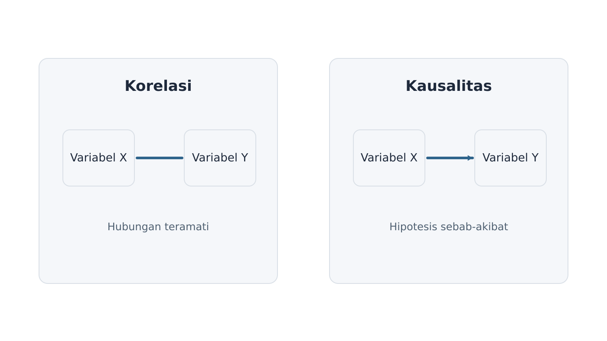
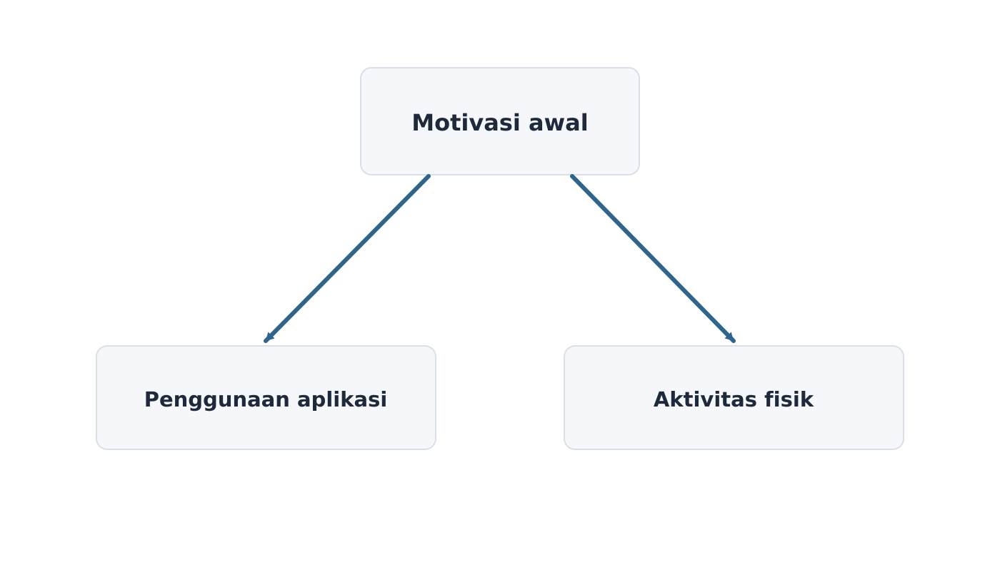
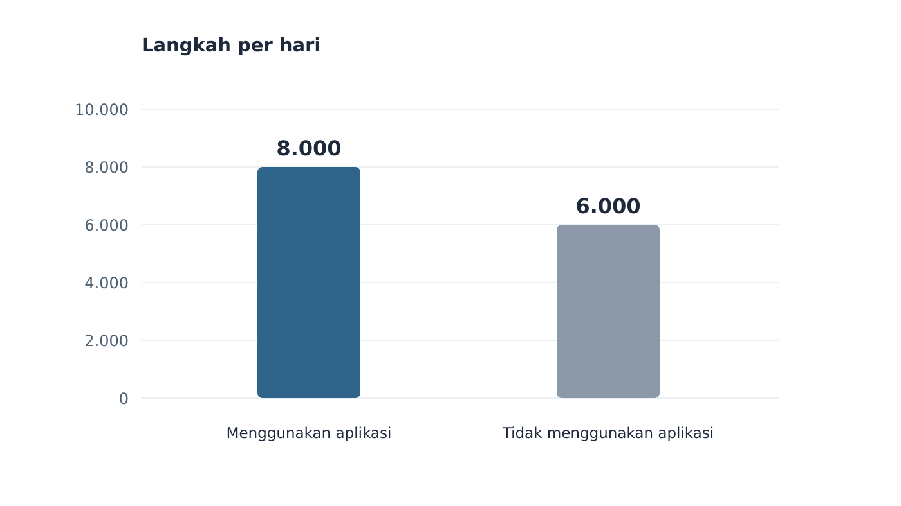

# Modul pembelajaran — statistics-id-draft-4

Teks orisinal Bahasa Indonesia dengan rujukan konseptual OpenStax, Introductory Statistics 2e. Materi untuk ditinjau sebelum pengambilan data. Judul modul dan ID subbab dipertahankan. Berkas ini merupakan salinan baca; sumber aplikasi berada pada `src/features/research/content.ts`.

# Sampling Bias

## Pengantar

Pengambilan sampel digunakan untuk memperoleh informasi tentang suatu populasi melalui pengamatan terhadap sebagian anggotanya. Ketepatan kesimpulan tidak hanya bergantung pada banyaknya data, tetapi juga pada proses pemilihan dan keikutsertaan responden. Modul ini membahas hubungan antara populasi dan sampel, teknik sampling, sumber bias, serta cara mengevaluasi hasil survei.

**Tujuan pembelajaran**

- Menjelaskan perbedaan populasi sasaran, kerangka sampel, sampel terpilih, dan responden akhir.
- Membandingkan teknik sampling dan mengidentifikasi mekanisme yang dapat menimbulkan bias.
- Menjelaskan pengaruh komposisi responden terhadap persentase survei serta membedakan variasi acak dan bias sistematis.
- Menilai kesesuaian generalisasi hasil survei dan mengusulkan perbaikan rancangan.

## 1. Populasi dan Sampel

Populasi dalam statistika adalah keseluruhan unit yang menjadi sasaran suatu penelitian. Unit tersebut dapat berupa orang, benda, kejadian, atau hasil pengukuran. Populasi perlu dibatasi menurut karakteristik, tempat, dan waktu agar sasaran kesimpulannya jelas. Sebagai contoh, populasi survei transportasi dapat didefinisikan sebagai seluruh mahasiswa aktif pada sebuah kampus dalam semester tertentu.

Sampel adalah sebagian unit populasi yang dipilih untuk dipelajari. Pengambilan sampel dilakukan karena mengamati seluruh populasi, atau melakukan sensus, dapat memerlukan biaya dan waktu yang besar. Dalam beberapa penelitian, akses terhadap seluruh anggota juga terbatas. Melalui prosedur yang tepat, informasi dari sampel dapat digunakan untuk memperkirakan karakteristik populasi, meskipun hasilnya tetap memiliki ketidakpastian.

Dalam pelaksanaannya, terdapat beberapa tahap yang perlu dibedakan. Populasi sasaran adalah kelompok yang ingin dicakup oleh kesimpulan. Kerangka sampel adalah daftar atau sumber yang digunakan untuk memilih anggotanya. Sampel terpilih berisi unit yang benar-benar dipilih atau diundang mengikuti penelitian. Responden akhir adalah bagian yang memberikan data. Keempat kelompok ini tidak selalu sama: daftar dapat tidak lengkap, dan sebagian orang yang diundang mungkin tidak menjawab.

Tahap pemilihan dan respons menentukan bagian populasi yang akhirnya teramati.

Misalnya, survei menargetkan seluruh mahasiswa aktif, menggunakan daftar administrasi kampus, memilih 200 mahasiswa, lalu menerima 150 jawaban. Populasinya tetap seluruh mahasiswa aktif; 200 orang merupakan sampel terpilih, sedangkan 150 orang merupakan responden akhir. Jika daftar administrasi belum diperbarui atau kelompok tertentu lebih sulit dihubungi, perbedaan dapat muncul sebelum analisis dilakukan.

Representativitas menunjukkan sejauh mana sampel mencerminkan karakteristik populasi yang relevan dengan pertanyaan penelitian. Dalam survei transportasi, jarak tempat tinggal dan moda perjalanan dapat lebih relevan daripada warna kesukaan. Sampel tidak harus identik dengan populasi pada setiap ciri, tetapi kelompok yang memiliki pengalaman berbeda perlu memperoleh keterwakilan yang memadai.

Generalisasi adalah perluasan kesimpulan dari data yang diamati kepada populasi sasaran. Dasarnya harus ditelaah melalui kerangka sampel, teknik pemilihan, dan pola respons. Banyaknya responden atau kesamaan satu karakteristik saja belum cukup menjamin bahwa hasil berlaku bagi seluruh populasi.

**Pertanyaan refleksi**

Pada survei transportasi, apa perbedaan antara menggunakan daftar seluruh mahasiswa aktif dan hanya daftar pengguna bus sebagai kerangka sampel?

## 2. Teknik Sampling dan Sumber Bias

Sampling bias merupakan kecenderungan penyimpangan hasil akibat proses pemilihan sampel yang secara sistematis lebih mewakili sebagian anggota populasi daripada anggota lainnya. Penyimpangan menjadi relevan ketika perbedaan keterwakilan berkaitan dengan karakteristik yang diteliti. Karena itu, penilaian bias harus mempertimbangkan tujuan penelitian dan cara responden diperoleh, bukan hanya nama teknik sampling.

Pada sampling probabilitas, pemilihan memakai mekanisme acak sehingga setiap anggota yang tercakup memiliki peluang terpilih yang diketahui dan lebih besar dari nol. Peluang tersebut tidak harus selalu sama. Pada sampling nonprobabilitas, peluang pemilihan setiap anggota tidak dapat ditentukan dengan cara yang sama; pemilihan dapat bergantung pada kemudahan akses atau kesediaan berpartisipasi. Keterbatasan ini perlu dipertimbangkan ketika hasil digeneralisasikan.

Simple random sampling memilih sampel berukuran tertentu sehingga setiap kemungkinan sampel berukuran itu memiliki peluang yang sama, misalnya melalui undian dari daftar lengkap. Stratified sampling membagi populasi menjadi kelompok atau strata yang relevan, kemudian memilih secara acak di setiap strata. Contohnya adalah memilih mahasiswa dari setiap jurusan sesuai proporsi jumlah mahasiswa. Pembagian strata saja belum cukup apabila pemilihan dalam strata tidak dilakukan sebagaimana direncanakan.

Teknik yang dipilih dapat memengaruhi komposisi sampel. Jika kelompok dengan pengalaman berbeda kurang terwakili, ringkasan seluruh responden dapat bergeser. Pada gambar berikut, sampel seimbang berarti komposisinya mendekati populasi, bukan bahwa kedua kelompok harus berjumlah sama. Kesesuaian komposisi pada satu ciri tetap tidak menjamin keterwakilan pada semua ciri.

Perbedaan komposisi perlu dinilai pada karakteristik yang berkaitan dengan topik penelitian.

Convenience sampling memilih unit yang mudah dijangkau, misalnya mahasiswa yang ditemui di kantin pada pagi hari. Teknik ini praktis, tetapi mahasiswa yang hadir pada waktu lain dapat memiliki kebiasaan berbeda. Risiko bias bergantung pada hubungan antara kemudahan dijangkau dan topik survei.

Undercoverage terjadi ketika sebagian kelompok tidak cukup tercakup dalam kerangka atau saluran perekrutan. Survei kebutuhan internet melalui grup penghuni asrama, misalnya, kurang menjangkau mahasiswa yang tinggal di luar asrama.

Voluntary response bias dapat muncul pada undangan terbuka ketika orang dengan pendapat tertentu lebih terdorong menjawab. Sebaliknya, nonresponse bias dapat muncul ketika sebagian unit yang sudah dipilih tidak menjawab dan ketidakikutsertaannya berkaitan dengan topik penelitian. Tidak menjawabnya sebagian undangan merupakan alasan untuk diperiksa, bukan bukti otomatis bahwa bias pasti terjadi.

Bias akibat pertanyaan survei berbeda dari masalah pemilihan responden. Pertanyaan yang menggiring atau membingungkan dapat memengaruhi jawaban bahkan ketika sampel dipilih dengan baik. Dengan demikian, suatu teknik tidak otomatis menghasilkan bias dalam setiap situasi, dan tidak ada nama teknik yang menggantikan pemeriksaan terhadap seluruh proses pengumpulan data.

**Pertanyaan refleksi**

Apa perbedaan mekanisme antara jajak pendapat terbuka yang diikuti secara sukarela dan survei terhadap mahasiswa terpilih yang sebagian tidak memberikan jawaban?

## 3. Dampak Sampling Bias terhadap Hasil Penelitian

Estimasi menggunakan informasi dari sampel untuk memperkirakan karakteristik populasi, seperti persentase mahasiswa yang mengeluhkan transportasi. Persentase gabungan dipengaruhi oleh tingkat keluhan dalam setiap kelompok serta komposisi kelompok yang menjawab. Ketimpangan komposisi perlu diperhatikan apabila kelompok-kelompok tersebut memiliki pengalaman yang berbeda.

Dalam contoh hipotetis berikut, populasi terdiri atas 1.000 mahasiswa dan survei memperoleh 200 responden. Tabel menyajikan komposisi populasi, komposisi responden, serta jumlah responden yang mengeluh. Persentase populasi memakai penyebut 1.000, sedangkan persentase responden memakai penyebut 200.

Komposisi populasi dan responden dalam survei transportasi hipotetis.

| Tempat tinggal | Populasi | % populasi | Responden | % responden | Responden mengeluh |
| --- | --- | --- | --- | --- | --- |
| Jauh | 600 | 60% | 40 | 20% | 30 |
| Dekat | 400 | 40% | 160 | 80% | 40 |
| Total | 1.000 | 100% | 200 | 100% | 70 |

Kelompok dengan tingkat keluhan lebih tinggi memiliki proporsi lebih kecil di antara responden.

Di antara responden yang tinggal jauh, tingkat keluhan adalah 30 / 40 × 100% = 75%. Pada kelompok yang tinggal dekat, tingkatnya 40 / 160 × 100% = 25%. Secara keseluruhan terdapat 70 keluhan dari 200 responden, sehingga persentase keluhan responden adalah (30 + 40) / 200 × 100% = 35%. Angka ini benar untuk data yang terkumpul.

Namun, kelompok yang tinggal jauh membentuk 60% populasi dan hanya 20% responden. Jika diasumsikan tingkat keluhan 75% dan 25% benar-benar berlaku pada populasi masing-masing kelompok, penggabungan menurut komposisi populasi menghasilkan 0,60 × 75% + 0,40 × 25% = 55%. Bobot 0,60 dan 0,40 menunjukkan bagian setiap kelompok dalam populasi. Perbandingan ini memperlihatkan pengaruh komposisi terhadap persentase gabungan.

Nilai 55% bukan nilai populasi yang pasti. Perhitungan tersebut bergantung pada asumsi bahwa responden dalam setiap kelompok mewakili kelompoknya. Apabila pemilihan atau respons di dalam kelompok juga bias, penyesuaian komposisi saja tidak menyelesaikan masalah.

Sampling variation adalah perbedaan hasil karena kebetulan ketika sampel berbeda diambil dengan prosedur yang sama. Bias sistematis berasal dari mekanisme yang cenderung menggeser hasil ke arah tertentu. Perbedaan sampel dari populasi tidak dengan sendirinya membuktikan bias; proses pemilihan dan hubungannya dengan hasil perlu diperiksa.

Dalam sampling acak yang dirancang dengan baik, memperbesar sampel umumnya mengurangi variasi acak. Akan tetapi, menambah responden dari saluran yang tetap melewatkan kelompok tertentu tidak otomatis menghilangkan bias. Peneliti perlu memeriksa karakteristik responden, kelompok yang tidak terjangkau, dan pola tidak menjawab sebelum menyamakan persentase responden dengan persentase populasi.

**Pertanyaan refleksi**

Mengapa 35% dapat menjadi ringkasan yang benar untuk responden, tetapi belum tentu menjadi perkiraan yang baik untuk populasi? Asumsi apa yang diperlukan untuk perhitungan 55%?

## 4. Evaluasi Hasil Survei

Evaluasi survei dimulai dengan menentukan populasi sasaran dari pertanyaan atau klaim dalam laporan. Periksa kelompok, tempat, dan waktu yang dimaksud. Pernyataan tentang seluruh mahasiswa, misalnya, memerlukan dasar yang lebih luas daripada pernyataan tentang mahasiswa pengguna satu fasilitas. Kesimpulan harus dibedakan dari deskripsi orang yang kebetulan memberikan jawaban.

Selanjutnya, periksa kerangka sampel dan teknik pemilihannya. Tanyakan dari daftar atau saluran mana responden diperoleh, siapa yang memiliki kesempatan terpilih, dan apakah prosedur yang disebutkan benar-benar dilaksanakan. Pemilihan acak dari daftar terbatas tetap menyisakan undercoverage bagi anggota populasi yang tidak terdapat pada daftar.

Pola respons juga perlu diperiksa. Jumlah yang diundang dan jumlah yang menjawab membantu menilai keikutsertaan, tetapi tingkat respons saja belum memastikan ada atau tidaknya bias. Apabila kelompok yang tidak menjawab mempunyai pengalaman berbeda, ringkasan dapat bergeser. Informasi mengenai karakteristik responden dan nonresponden membantu menilai kemungkinan tersebut.

Sebagai penerapan, sebuah survei menilai kecukupan jam operasional laboratorium bagi seluruh mahasiswa Saintek. Tautannya hanya dibagikan melalui grup asisten laboratorium, dan 82% responden menyatakan jamnya memadai. Karena asisten mungkin memiliki akses serta jadwal berbeda, hasil ini belum otomatis mewakili seluruh mahasiswa. Undangan terbuka juga memungkinkan anggota dengan pendapat tertentu lebih terdorong berpartisipasi.

Kesimpulan yang didukung langsung adalah bahwa 82% responden survei tersebut menilai jam operasional memadai. Untuk memperluas kesimpulan, rancangan dapat diperbaiki dengan kerangka yang mencakup mahasiswa sasaran, pemilihan yang sesuai tujuan, serta tindak lanjut kepada unit terpilih yang belum menjawab. Kelompok seperti mahasiswa nonasisten dan pengguna dengan jadwal berbeda perlu memperoleh kesempatan yang memadai. Pertanyaan survei juga harus jelas dan tidak menggiring.

Secara berurutan, tentukan populasi sasaran, cocokkan kerangka sampelnya, telaah cara pemilihan, periksa respons, lalu nilai batas kesimpulannya. Pada setiap tahap, cari kelompok yang dapat terlewat dan kaitannya dengan pertanyaan penelitian. Langkah ini dapat diterapkan pada laporan survei lain tanpa menganggap bahwa banyaknya jawaban atau satu label teknik sudah menjamin kualitas hasil.

Batas kesimpulan ditelaah melalui seluruh rangkaian pengumpulan data.

**Pertanyaan refleksi**

Untuk survei laboratorium tersebut, tuliskan satu kesimpulan yang didukung data dan dua perbaikan rancangan beserta mekanisme bias yang ingin dikurangi.

## Glosarium

| Istilah | Penjelasan |
|---|---|
| Populasi | Keseluruhan unit yang menjadi sasaran penelitian; batas kelompok, tempat, dan waktunya perlu dijelaskan. |
| Sampel | Sebagian unit populasi yang dipilih untuk dipelajari. Dalam laporan, bedakan unit yang dipilih dan unit yang akhirnya memberikan data. |
| Populasi sasaran | Kelompok yang ingin dicakup oleh kesimpulan penelitian. |
| Kerangka sampel | Daftar atau sumber operasional yang digunakan untuk memilih anggota populasi. Kelengkapannya memengaruhi siapa yang dapat dijangkau. |
| Sampel terpilih | Unit yang benar-benar dipilih atau diundang untuk mengikuti pengumpulan data. |
| Responden akhir | Unit yang akhirnya memberikan jawaban atau data setelah proses pemilihan dan perekrutan. |
| Representativitas | Keterwakilan karakteristik populasi yang relevan dengan pertanyaan penelitian di dalam sampel. |
| Generalisasi | Perluasan kesimpulan dari unit yang diamati kepada populasi sasaran, dengan mempertimbangkan dasar pemilihan dan keterbatasan data. |
| Sampling bias | Kecenderungan penyimpangan karena proses pemilihan secara sistematis lebih mewakili sebagian anggota populasi dan berkaitan dengan karakteristik yang diteliti. |
| Sampling probabilitas | Pemilihan dengan mekanisme acak dan peluang terpilih yang diketahui serta lebih besar dari nol bagi anggota yang tercakup. |
| Sampling nonprobabilitas | Pemilihan yang tidak memberikan dasar peluang terpilih setiap anggota seperti pada sampling probabilitas, misalnya berdasarkan akses atau kesediaan. |
| Simple random sampling | Pemilihan yang memberi setiap kemungkinan sampel berukuran tertentu peluang yang sama. |
| Stratified sampling | Pembagian populasi ke dalam strata, diikuti pemilihan acak dari setiap strata; alokasi dapat mengikuti proporsi populasi. |
| Convenience sampling | Pemilihan unit yang mudah dijangkau; risikonya bergantung pada hubungan kemudahan akses dengan topik penelitian. |
| Undercoverage | Keadaan ketika sebagian kelompok populasi tidak cukup tercakup dalam kerangka atau saluran perekrutan. |
| Voluntary response bias | Bias yang dapat muncul ketika kecenderungan mengikuti undangan terbuka berkaitan dengan pendapat atau pengalaman yang diteliti. |
| Nonresponse bias | Bias yang dapat muncul ketika unit terpilih yang tidak menjawab berbeda secara relevan dari unit yang menjawab. |
| Sampling variation | Perbedaan hasil karena kebetulan ketika sampel berbeda diambil dengan prosedur yang sama. |
| Bias sistematis | Kecenderungan mekanisme pengumpulan data menggeser hasil ke arah tertentu, yang tidak otomatis hilang ketika sampel diperbesar. |
| Estimasi | Penggunaan informasi sampel untuk memperkirakan suatu karakteristik populasi. |

## Referensi konseptual

- [OpenStax Introductory Statistics 2e — 1.1 Definitions of Statistics, Probability, and Key Terms](https://openstax.org/books/introductory-statistics-2e/pages/1-1-definitions-of-statistics-probability-and-key-terms)
- [OpenStax Introductory Statistics 2e — 1.2 Data, Sampling, and Variation in Data and Sampling](https://openstax.org/books/introductory-statistics-2e/pages/1-2-data-sampling-and-variation-in-data-and-sampling)

# Correlation vs Causation

## Pengantar

Hubungan antara dua variabel dapat dipelajari melalui pasangan pengamatan, grafik, dan perbandingan ringkasan data. Akan tetapi, hubungan yang terlihat belum selalu menjelaskan penyebabnya. Modul ini membahas cara membaca scatter plot, membedakan korelasi dan kausalitas, mengenali confounding, serta menilai kesimpulan berdasarkan desain studi.

**Tujuan pembelajaran**

- Membaca pasangan pengamatan, arah, kekuatan, dan penyimpangan pola pada scatter plot.
- Membedakan hubungan statistik dengan hubungan sebab-akibat serta mengenali penjelasan alternatif.
- Menjelaskan confounding dan perbedaan studi observasional, eksperimen, random sampling, dan random assignment.
- Menafsirkan perbedaan rata-rata dua kelompok sesuai bukti dan keterbatasan rancangan studi.

## 1. Variabel dan Scatter Plot

Variabel adalah karakteristik yang nilainya dapat berbeda antarunit pengamatan. Contohnya meliputi waktu latihan, jumlah langkah, suhu, dan skor tes. Ketika hubungan dua variabel dipelajari, kedua nilai perlu berasal dari unit yang sama atau pasangan yang memang sesuai. Menggabungkan jam latihan seseorang dengan skor orang lain akan menghasilkan pasangan yang tidak menggambarkan hubungan yang hendak dipelajari.

Scatter plot adalah grafik untuk menampilkan pengamatan berpasangan. Variabel X diletakkan pada sumbu mendatar dan variabel Y pada sumbu tegak. Nama serta satuan sumbu menentukan cara membacanya. Jika X adalah jam latihan per minggu dan Y adalah skor tes, titik (4, 65) menunjukkan seorang peserta yang berlatih empat jam dan memperoleh skor 65. Pemilihan sumbu tidak dengan sendirinya menetapkan sebab-akibat.

Dalam pola positif, nilai X yang lebih tinggi cenderung disertai nilai Y yang lebih tinggi. Dalam pola negatif, nilai X yang lebih tinggi cenderung disertai nilai Y yang lebih rendah. Sebagai contoh, waktu perjalanan yang lebih lama dapat berpasangan dengan waktu tidur yang lebih pendek. Positif dan negatif menunjukkan arah hubungan, bukan penilaian baik atau buruk.

Arah hubungan terlihat dari pola pasangan X dan Y; kekuatannya perlu dinilai dari sebaran titik.

Kekuatan hubungan linear menunjukkan seberapa rapat titik mengikuti pola garis lurus yang tidak mendatar. Pada dua pola positif, pola dengan titik lebih dekat ke garis menunjukkan hubungan linear yang lebih kuat. Hal yang sama berlaku pada pola negatif. Kemiringan garis tidak sama dengan kekuatan hubungan; perubahan satuan sumbu dapat mengubah kemiringan tanpa mengubah keteraturan pasangan data.

Apabila titik tersebar tanpa arah linear yang jelas, hubungan linear mungkin lemah. Namun, hal ini tidak membuktikan bahwa kedua variabel sama sekali tidak berhubungan. Pola berbentuk U, misalnya, menunjukkan hubungan nonlinear yang dapat tidak tercermin dalam korelasi linear. Nilai korelasi linear mendekati nol perlu dibaca bersama bentuk grafiknya.

Outlier adalah pengamatan yang menyimpang dari pola umum. Pengamatan semacam ini dapat memengaruhi ringkasan hubungan sehingga perlu diperiksa konteks serta ketepatan pengukurannya, bukan langsung dibuang. Secara keseluruhan, pembacaan scatter plot mencakup pasangan dan satuan data, arah pola, kekuatan hubungan, bentuk nonlinear, serta titik yang menyimpang.

**Pertanyaan refleksi**

Apa informasi yang diwakili satu titik pada scatter plot? Mengapa korelasi linear yang kecil belum meniadakan kemungkinan hubungan berbentuk U?

## 2. Korelasi dan Kausalitas

Korelasi menyatakan hubungan statistik antara variabel: nilai suatu variabel mempunyai pola keterkaitan dengan nilai variabel lain. Dalam pembahasan hubungan linear, perhatian diarahkan pada arah dan kekuatan pola garis lurus. Pola tersebut meringkas kecenderungan dalam data; pola tidak mengharuskan setiap pengamatan memiliki nilai yang tepat sama dengan kecenderungan umum.

Kausalitas menyatakan hubungan sebab-akibat, yaitu perubahan suatu faktor menghasilkan perubahan pada faktor lain melalui suatu mekanisme. Untuk mendukung klaim ini, peneliti perlu membedakan pengaruh faktor tersebut dari penjelasan alternatif. Dengan demikian, pernyataan bahwa dua variabel berhubungan dan pernyataan bahwa satu variabel menyebabkan perubahan variabel lain mengandung tuntutan bukti yang berbeda.

Garis hubungan dan panah sebab-akibat menyatakan jenis klaim yang berbeda; panah tetap memerlukan dukungan bukti.

Korelasi yang kuat belum otomatis menjadi bukti kausalitas. Keteraturan pasangan pengamatan tidak menjelaskan sendiri urutan kejadian, proses pemilihan unit, atau faktor lain yang bekerja. Bahkan jika hubungan dapat digunakan untuk membuat perkiraan yang cukup baik, ketepatan perkiraan tidak menetapkan apa yang akan terjadi apabila peneliti sengaja mengubah salah satu variabel.

Sebagai contoh, pengguna aplikasi kebugaran dapat terlihat lebih aktif daripada nonpengguna. Salah satu penjelasannya adalah aplikasi membantu meningkatkan aktivitas. Namun, arah hubungan terbalik juga mungkin: orang yang telah aktif lebih tertarik menggunakan aplikasi. Karena itu, kondisi sebelum penggunaan dan urutan waktunya perlu diketahui.

Penjelasan lain adalah adanya faktor ketiga, seperti motivasi awal untuk hidup sehat, yang berhubungan dengan penggunaan aplikasi sekaligus aktivitas fisik. Lebih dari satu mekanisme dapat berlangsung bersamaan. Menemukan penjelasan alternatif tidak membuktikan bahwa aplikasi tidak bermanfaat; hal itu menunjukkan bahwa hubungan yang diamati belum cukup untuk menentukan besarnya pengaruh aplikasi.

Hubungan statistik tetap berguna meskipun kesimpulan sebab-akibat belum dapat dibuat. Pola dapat membantu menggambarkan data, menyusun hipotesis, atau memperkirakan nilai pada kondisi yang sebanding. Regresi, secara konseptual, digunakan untuk meringkas hubungan dan membuat perkiraan. Namun, persamaan atau prediksi statistik saja tidak menggantikan bukti tentang mekanisme dan desain studi. Dalam membaca laporan, bedakan bahasa hubungan, seperti 'berkaitan dengan', dari bahasa kausal, seperti 'menyebabkan'.

**Pertanyaan refleksi**

Sebuah laporan menyebut pengguna aplikasi kebugaran lebih aktif. Tuliskan satu penjelasan yang melibatkan pengaruh aplikasi dan satu penjelasan dengan arah hubungan terbalik.

## 3. Confounding dan Desain Studi

Confounding terjadi ketika pengaruh faktor yang sedang diteliti bercampur dengan pengaruh faktor lain sehingga penjelasan hubungan sulit dipisahkan. Confounding variable, atau faktor perancu, merupakan variabel yang dapat memberikan penjelasan alternatif terhadap hubungan tersebut. Penetapannya memerlukan alasan tentang hubungan dan urutan waktu; tidak setiap variabel tambahan otomatis merupakan faktor perancu.

Pada studi aplikasi kebugaran, motivasi awal dapat meningkatkan kecenderungan seseorang menggunakan aplikasi sekaligus mendorong aktivitas fisik yang lebih tinggi. Apabila pengguna sejak awal lebih termotivasi, perbedaan aktivitas setelahnya dapat mencerminkan motivasi, pengaruh aplikasi, atau keduanya. Diagram menunjukkan kemungkinan motivasi awal memengaruhi dua variabel yang diamati. Panah menggambarkan hipotesis mekanisme, bukan pembuktian otomatis dari data.

Motivasi awal dapat menjadi penjelasan bersama bagi penggunaan aplikasi dan aktivitas fisik.

Studi observasional mencatat keadaan atau perilaku tanpa peneliti menetapkan perlakuan yang sedang dibandingkan. Peneliti, misalnya, mengamati pengguna dan nonpengguna aplikasi yang sudah ada. Studi ini dapat menemukan hubungan, tetapi perbedaan awal antarkelompok perlu dipertimbangkan sebelum membuat klaim kausal.

Dalam eksperimen, peneliti menetapkan perlakuan dan mengamati hasilnya. Random assignment membagi peserta secara acak ke kondisi perlakuan dan pembanding. Dengan prosedur yang tepat, pengacakan mengurangi kecenderungan perbedaan awal yang sistematis, termasuk faktor yang tidak seluruhnya terukur. Akan tetapi, pengacakan tidak menjamin setiap karakteristik persis sama pada kelompok yang terbentuk, terutama apabila jumlah peserta kecil.

Random sampling berbeda dari random assignment. Random sampling memilih unit dari populasi dan berkaitan dengan dasar keterwakilan serta generalisasi. Random assignment membagi peserta yang sudah tersedia ke kondisi penelitian dan membantu membedakan pengaruh perlakuan dari perbedaan awal. Sebuah studi dapat menggunakan salah satunya tanpa menggunakan yang lain; keduanya menjawab persoalan yang berbeda.

Perbedaan tujuan dua jenis pengacakan.

| Prosedur | Tahap yang diacak | Tujuan utama |
| --- | --- | --- |
| Random sampling | Pemilihan unit dari populasi | Mendukung dasar keterwakilan dan generalisasi |
| Random assignment | Pembagian peserta ke kondisi studi | Mengurangi perbedaan awal sistematis antarkondisi |

Kesimpulan kausal juga bergantung pada pelaksanaan studi. Pengukuran hasil harus sebanding, perlakuan harus dijalankan sesuai rancangan, dan peserta yang keluar dari studi perlu diperhatikan. Random assignment tidak otomatis memperbaiki sampel yang tidak mewakili populasi. Sebaliknya, sampel acak tidak dengan sendirinya menghilangkan confounding pada perbandingan observasional. Karena itu, mutu desain dan batas kesimpulan perlu dinilai secara terpisah.

**Pertanyaan refleksi**

Jika peserta dipilih secara acak dari kampus tetapi memilih sendiri penggunaan aplikasi, prosedur pengacakan apa yang sudah dilakukan dan masalah apa yang masih perlu diperiksa?

## 4. Interpretasi Hasil Studi

Perbandingan dua kelompok dapat diringkas melalui rata-rata hasil masing-masing kelompok. Rata-rata dihitung dengan menjumlahkan nilai seluruh anggota kelompok, kemudian membaginya dengan jumlah anggota yang diamati. Dua kelompok dapat mempunyai rata-rata berbeda meskipun beberapa nilai anggotanya saling tumpang tindih. Agar perbandingan bermakna, definisi hasil, satuan, periode pengamatan, dan cara pengukurannya perlu sebanding. Selisih yang teramati belum dengan sendirinya menjelaskan penyebab perbedaan.

Sebuah studi hipotetis mengamati 120 mahasiswa. Pengguna aplikasi kebugaran berjalan rata-rata 8.000 langkah per hari, sedangkan nonpengguna berjalan rata-rata 6.000 langkah per hari. Penggunaan aplikasi dipilih oleh masing-masing peserta dan tidak ditetapkan melalui random assignment. Tabel berikut merangkum hasil pengamatan tersebut.

Rata-rata aktivitas harian dalam studi hipotetis terhadap 120 mahasiswa.

| Kelompok | Rata-rata langkah per hari | Penentuan penggunaan aplikasi |
| --- | --- | --- |
| Menggunakan aplikasi | 8.000 | Pilihan peserta |
| Tidak menggunakan aplikasi | 6.000 | Pilihan peserta |

Perbedaan aktivitas menggambarkan hasil dua kelompok yang terbentuk melalui pilihan peserta.

Perbedaan rata-rata yang teramati adalah 8.000 − 6.000 = 2.000 langkah per hari. Angka ini menyatakan bahwa kelompok pengguna pada sampel memiliki rata-rata lebih tinggi. Angka tersebut bukan bukti bahwa aplikasi menyebabkan setiap pengguna menambah 2.000 langkah, dan belum menetapkan efek kausal rata-rata aplikasi pada populasi.

Self-selection terjadi ketika peserta memilih sendiri keterlibatannya, termasuk keputusan menggunakan aplikasi. Pengguna mungkin sejak awal lebih termotivasi, lebih aktif, atau memiliki rutinitas perjalanan yang berbeda. Karakteristik tersebut dapat memengaruhi aktivitas sekaligus pilihan menggunakan aplikasi. Perbandingan tanpa informasi awal dapat mencampurkan pengaruh aplikasi dengan perbedaan yang sudah ada.

Klaim 'aplikasi meningkatkan aktivitas sebesar 2.000 langkah' lebih kuat daripada bukti yang tersedia. Kesimpulan yang didukung langsung adalah bahwa pengguna aplikasi dalam sampel berjalan rata-rata 2.000 langkah per hari lebih banyak daripada nonpengguna. Membatasi kesimpulan seperti ini tidak meniadakan kegunaan temuan; hasilnya dapat menjadi dasar hipotesis untuk penelitian berikutnya.

Bukti kausal yang lebih baik dapat diperoleh melalui eksperimen dengan random assignment, kondisi pembanding yang sebanding, dan pengukuran aktivitas awal. Kedua kelompok perlu diukur dengan cara serta periode yang sama, disertai pencatatan kepatuhan dan peserta yang keluar. Saat mengevaluasi laporan, periksa hasil yang benar-benar diamati, cara kelompok terbentuk, penjelasan alternatif, serta kemampuan desain untuk membedakan penjelasan tersebut. Generalisasi tetap memerlukan penilaian atas populasi dan pemilihan peserta.

**Pertanyaan refleksi**

Tuliskan kembali klaim peningkatan 2.000 langkah agar sesuai dengan studi observasional tersebut. Informasi awal apa yang membantu menilai penjelasan alternatifnya?

## Glosarium

| Istilah | Penjelasan |
|---|---|
| Variabel | Karakteristik yang nilainya dapat berbeda antarunit pengamatan, seperti waktu latihan, jumlah langkah, atau skor tes. |
| Pengamatan berpasangan | Dua nilai variabel yang berasal dari unit yang sama atau pasangan yang memang sesuai untuk dibandingkan. |
| Scatter plot | Grafik pasangan nilai X dan Y; satu titik mewakili satu pengamatan berpasangan. |
| Pola positif | Kecenderungan nilai X yang lebih tinggi disertai nilai Y yang lebih tinggi. |
| Pola negatif | Kecenderungan nilai X yang lebih tinggi disertai nilai Y yang lebih rendah. |
| Kekuatan hubungan linear | Kerapatan titik mengikuti pola garis lurus yang tidak mendatar; berbeda dari arah dan kemiringan hubungan. |
| Hubungan nonlinear | Keterkaitan yang tidak mengikuti pola garis lurus, misalnya pola berbentuk U. |
| Outlier | Pengamatan yang menyimpang dari pola umum dan perlu diperiksa konteks serta ketepatan pengukurannya. |
| Korelasi | Hubungan statistik antarvariabel. Arah dan kekuatannya tidak dengan sendirinya membuktikan sebab-akibat. |
| Kausalitas | Hubungan sebab-akibat ketika perubahan suatu faktor menghasilkan perubahan pada faktor lain. |
| Arah hubungan terbalik | Kemungkinan bahwa arah sebab-akibat berbeda dari dugaan awal, misalnya aktivitas yang sudah tinggi mendorong penggunaan aplikasi. |
| Confounding | Keadaan ketika pengaruh faktor yang diteliti bercampur dengan faktor lain sehingga penjelasan hubungan sulit dipisahkan. |
| Confounding variable | Faktor perancu yang dapat menjelaskan hubungan melalui pengaruh atau keterkaitan yang masuk akal dengan variabel yang diamati. |
| Studi observasional | Studi yang mengamati keadaan tanpa peneliti menetapkan perlakuan yang sedang dibandingkan. |
| Eksperimen | Studi yang menetapkan perlakuan dan mengamati hasilnya; pengacakan pembagian kondisi dapat memperkuat evaluasi pengaruh perlakuan. |
| Random sampling | Pemilihan unit dari populasi menggunakan mekanisme acak; berkaitan dengan dasar keterwakilan dan generalisasi. |
| Random assignment | Pembagian peserta secara acak ke kondisi perlakuan atau pembanding untuk mengurangi perbedaan awal yang sistematis. |
| Self-selection | Pemilihan keterlibatan oleh peserta sendiri yang dapat menghasilkan perbedaan karakteristik awal antarkelompok. |
| Perbedaan rata-rata | Selisih ringkasan rata-rata dua kelompok; dalam studi observasional tidak otomatis sama dengan efek kausal. |
| Efek kausal | Perubahan hasil yang dapat diatribusikan pada suatu perlakuan, dengan membedakannya dari penjelasan alternatif. |

## Referensi konseptual

- [OpenStax Introductory Statistics 2e — 12.2 Scatter Plots](https://openstax.org/books/introductory-statistics-2e/pages/12-2-scatter-plots)
- [OpenStax Introductory Statistics 2e — 12.3 The Regression Equation (konsep hubungan dan prediksi)](https://openstax.org/books/introductory-statistics-2e/pages/12-3-the-regression-equation)
- [OpenStax Introductory Statistics 2e — 1.4 Experimental Design and Ethics](https://openstax.org/books/introductory-statistics-2e/pages/1-4-experimental-design-and-ethics)
